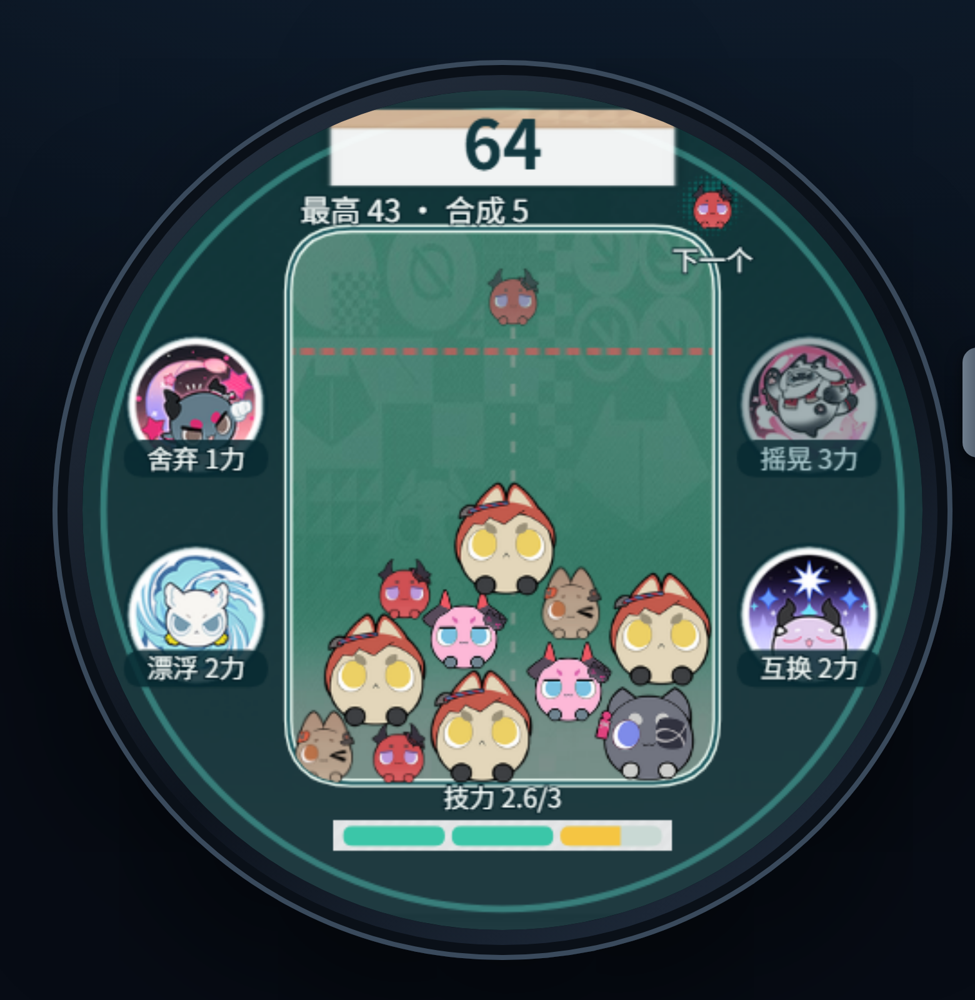
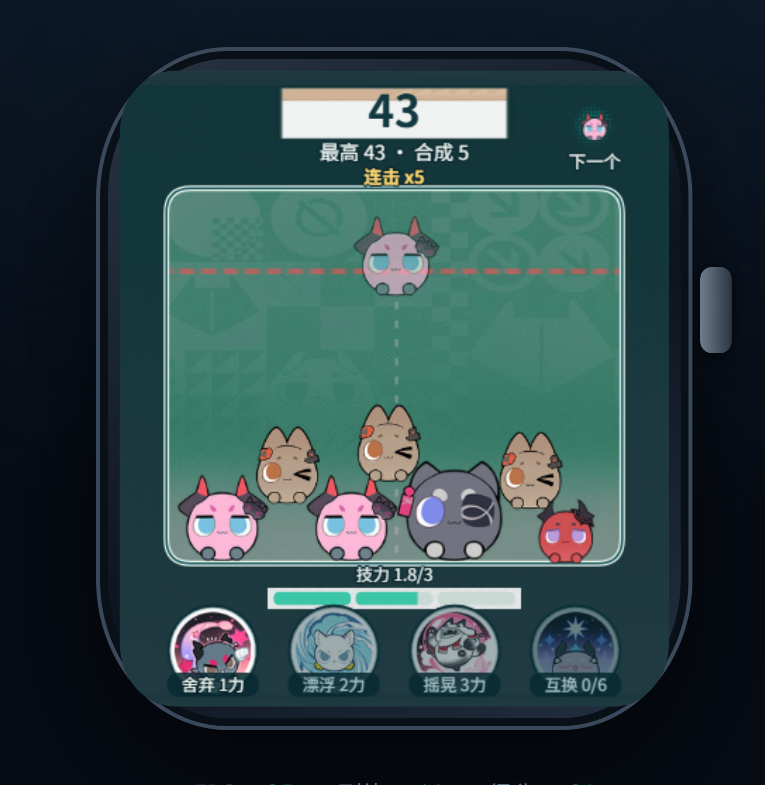

# 腕上团团 · HarmonyOS 6 智能手表重制版

《明日方舟：终末地》「融合！山团团！」的 HarmonyOS 智能手表重制工程。

参照原版（[palmcivet.tech/orbipom-merge](https://palmcivet.tech/orbipom-merge/play/game.html)）重制核心玩法：
物理掉落、同级融合、11 级图鉴、连击计分、红线 3 秒判负、技力与四大战技。

<table>
<tr><td></td><td></td></tr>
<tr><td align="center">圆形表盘</td><td align="center">方形表盘</td></tr>
</table>

## 快速开始

**浏览器预览**（无需工具链）：直接用浏览器打开 [`preview/index.html`](preview/index.html)，
可切圆形/方形表盘布局、投球、放战技、查看 HUD 与参数说明。

**真机 / 模拟器**：用 DevEco Studio 打开本仓库（工程根目录即 `build-profile.json5` 所在处），
选择 HarmonyOS 6 模拟器或手表真机运行。首次同步需在 `local.properties` 填入 SDK 路径。

## 目录结构

```
AppScope/                       应用级配置与图标
entry/src/main/
├── ets/
│   ├── entryability/            EntryAbility / EntryBackupAbility
│   ├── pages/Index.ets          全屏 Canvas 宿主页
│   └── game/                    游戏本体（纯 ArkTS，无 UI 组件树）
│       ├── Config.ets           玩法常量：11 级配置、战技、红线、技力、球体缩放
│       ├── Model.ets            Body / UiButton / SkillButton 数据结构
│       ├── Layout.ets           表盘布局（圆/方两套坐标）
│       ├── GameEngine.ets       物理与状态机（固定步长 1/120s）
│       ├── Renderer.ets         全部 Canvas 绘制（薄荷绿主题、兽脸团团、管理员丢球）
│       ├── Input.ets            触摸 / 表冠输入
│       ├── Assets.ets           原版素材加载与解码
│       ├── SoundKit.ets         音效
│       ├── FontKit.ets          思源黑体注册（失败回退系统字体）
│       └── SaveStore.ets        最高分 / 图鉴进度持久化
└── resources/
    ├── base/media/              原版图片素材（团团圆贴、战技头像、面板、UI）
    └── rawfile/                 音效与字体
preview/index.html               浏览器版预览（与 ArkTS 端逻辑镜像）
```

预览页与手表端共用同一套玩法参数与绘制逻辑，两端行为一致。

## 玩法与机制（对齐原版）

| 机制 | 说明 |
| --- | --- |
| 物理掉落 | 固定步长 1/120s、5 次迭代松弛求解；接触约束 + 摩擦 + 墙面反弹 |
| 同级融合 | 相同等级相撞 → 升一级；11 级「黄金管理员」双星同撞触发终极融合清场 |
| 图鉴 | 11 级团团图鉴，逐级解锁并持久化 |
| 连击 | 1.4s 窗口内连续合成累计倍率 |
| 红线 | 容器上方红线，3 秒倒计时，触碰即判负 |
| 技力 | 3 格技力 + 12 格进度环（未满那格按原版节奏衰减） |
| 战技 | 舍弃 / 漂浮 / 摇晃 / 互换；漂浮为「虚拟水面 + 浮力」模型，摇晃为整堆同速上抛 |
| 管理员丢球 | 团团由容器口的管理员从袋子里丢出，而非凭空出现 |

### 视觉

薄荷绿底 + 白卡 + 暖棕金黄点缀，团团是带白脸兽表情的圆形山团团，
战技图标使用原版动物头像素材，红色危险线为红绿相间矩形段（对齐原版 danger-line）。

## 许可

- 代码：[GPL-3.0](LICENSE)（与原版一致）
- 素材：来自《明日方舟：终末地》「融合！山团团！」原版资源，仅用于本重制项目
- 代码参考https://github.com/palmcivet/orbipom-merge
